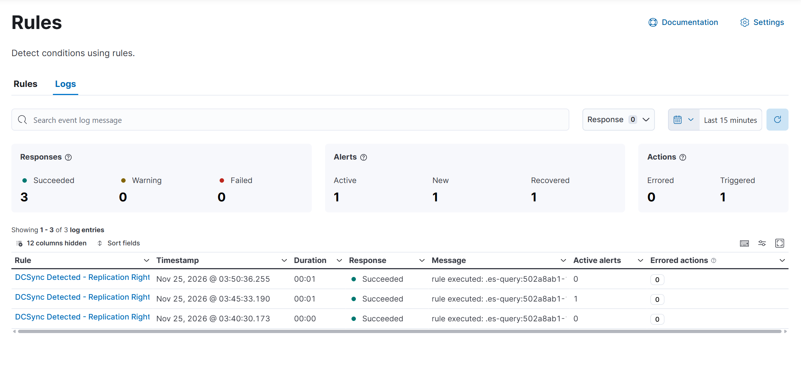
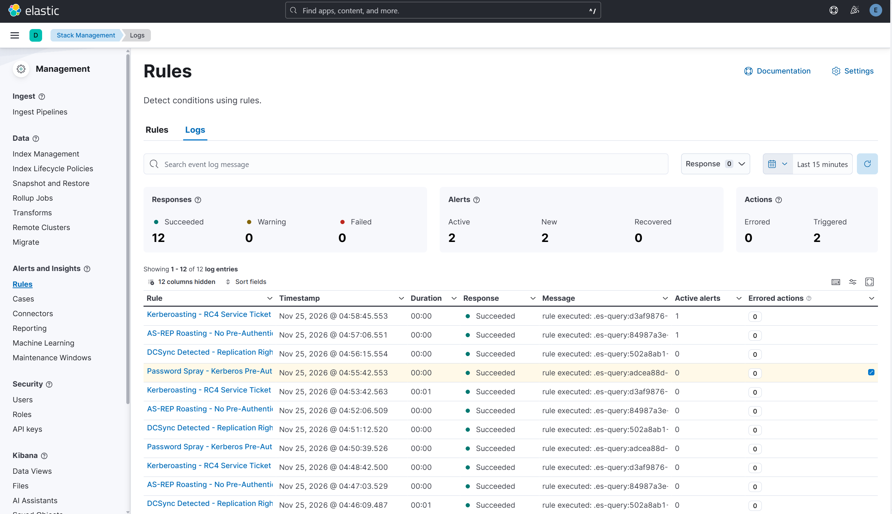
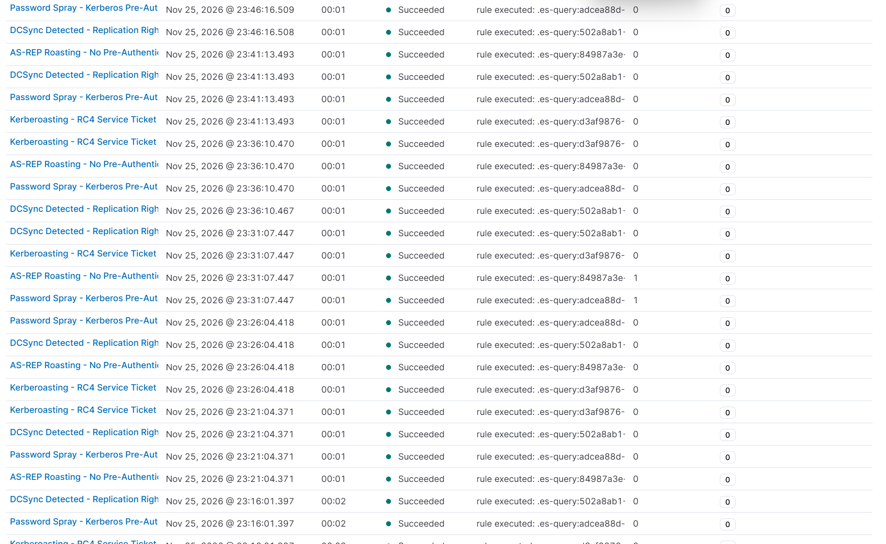
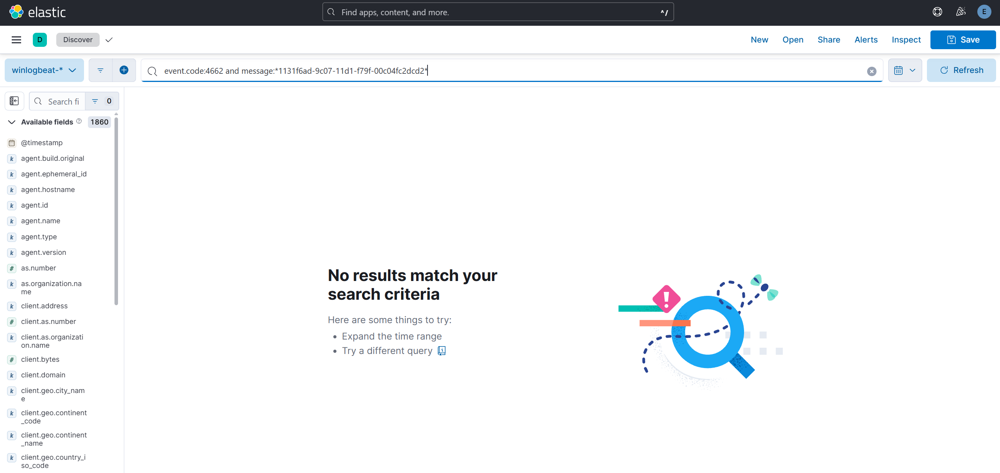
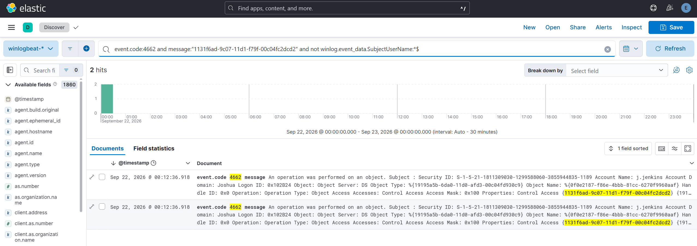
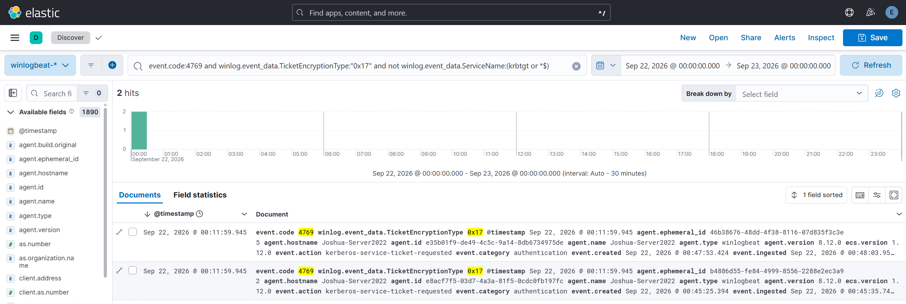
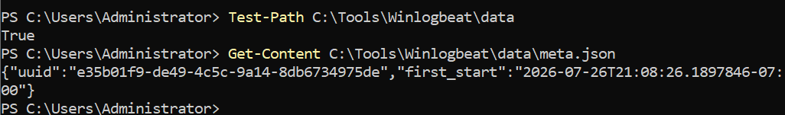
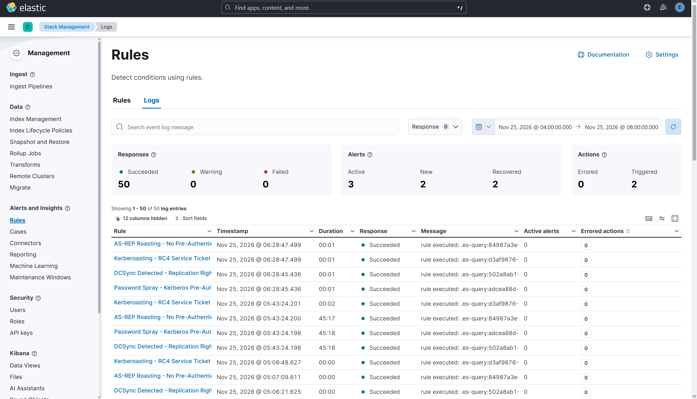
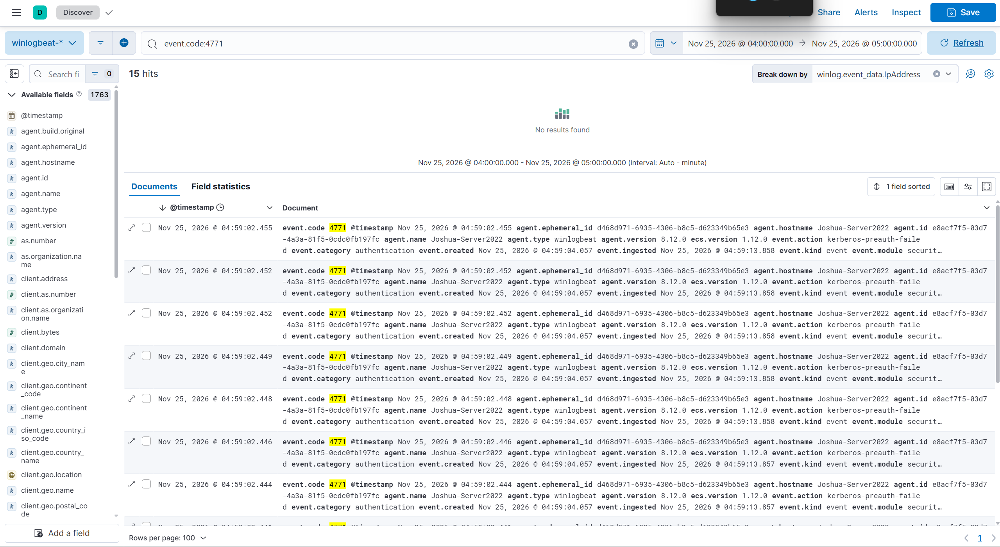

# Detection Validation Results

There are two rounds of testing in this repo, and they checked different things:

1. **September 2026:** I ran the Caldera operation and checked that each attack's events reached Elastic. They did. No rule alerted, because three of the four rules were never deployed and the fourth was broken.
2. **November 2026 re-test:** I deployed all four detections as Kibana alerting rules, fixed the problems I found, and re-ran the attacks. Every technique raised a real alert.

All times below are UTC, which is what my Kibana displays. Caldera displays my local time (GMT+1), so its screenshots read one hour later.

## Summary

| Technique | ATT&CK ID | Sept: events in Elastic | Sept: alert | Nov: alert |
|---|---|---|---|---|
| Password Spraying | T1110.003 | Yes, 4771 | No | ✅ 25 Nov, 23:31:07 |
| Kerberoasting | T1558.003 | Yes, 4769 RC4 | No | ✅ 25 Nov, 04:58:45 |
| AS-REP Roasting | T1558.004 | Yes, 4768 PreAuthType 0 | No | ✅ 25 Nov, 05:02:06 |
| DCSync | T1003.006 | Yes, 4662 | No | ✅ 25 Nov, 03:45:33 |
| LLMNR/NBT-NS Poisoning | T1557.001 | No | No | ❌ Still a gap |

The rule definitions are in [`kibana-rules.md`](kibana-rules.md).

## November re-test

### DCSync (T1003.006)

I ran the DCSync ability on its own from Caldera at 03:44:34. The rule's next run at 03:45:33 raised an alert: Active 1, New 1, one action triggered. On the run after that it showed as Recovered, which is expected with a rolling window.

The DCSync step of the full operation hadn't run when I captured its results, so this result comes from the standalone run.

### Kerberoasting (T1558.003)

The full operation ran Kerberoasting at 04:55:37 and again at 04:57:49. The rule alerted at 04:58:45.

### AS-REP Roasting (T1558.004)

The AS-REP ability ran at 04:59:26 and the rule alerted at 05:02:06.

The same rule also alerted at 04:57:06, two minutes *before* the AS-REP ability ran, and again at 23:31:07 alongside the password spray. My working explanation is that `j.jenkins` is configured not to require Kerberos pre-authentication (that's what makes it AS-REP-roastable in this lab), so any Kerberos login for that account produces a 4768 with `PreAuthType: 0`. Earlier abilities and the spray both touch `j.jenkins`. I haven't confirmed this yet. If it holds, the rule can't tell an attacker's AS-REP request from a normal login by that account, and the real fix is to require pre-authentication on every account.

### Password Spraying (T1110.003)

The spray in the full operation produced 15 failed pre-authentication events (4771) at 04:59:02, ingested 11 seconds later, but the rule didn't alert (finding 6). After I changed the rule to count across all documents, I ran the spray ability again and the rule alerted at 23:31:07.

## What went wrong in September, and what I fixed

I found six separate problems. Any one of them was enough to stop an alert.

### 1. The DCSync query could never match

The rule searched `message:*1131f6ad-9c07-11d1-f79f-00c04fc2dcd2*`. `message` is a text field, so Elasticsearch splits it into words before storing it, and it treats hyphens as word breaks. A wildcard is checked against one word at a time, and no single word contains a hyphen, so it matched nothing. Searching the GUID as a quoted phrase fixed it.

| Query on 22 Sep | Hits |
|---|---|
| `message:*1131f6ad-...*` (wildcard) | 0 |
| `message:"1131f6ad-..."` (phrase) | 2 |

The DCSync write-up in my AD lab (Cybersecurity-Labs, Phase 5B) appears to treat "Last response: Succeeded" as proof the rule fired. That status only means the rule ran without errors. Given the query above could never match, that claim needs checking and probably the same correction.

### 2. The September events arrived 35 minutes late

The attack events have an `@timestamp` of 00:11:59 but an `event.ingested` of 00:45 and 00:48. The rule searched by `@timestamp` over the last 5 minutes, so by the time the events arrived they were already outside every window. The rule's first run that day was at 00:21, after the attack, and it never looks back that far.

Fix: a 15-minute look-back on a 5-minute schedule, plus findings 4 and 5.

### 3. Two copies of Winlogbeat were shipping the same events

Every September event appears twice, from two `agent.id` values. One is the Winlogbeat service (data in `C:\ProgramData\winlogbeat`). The other is an older copy whose data folder, `C:\Tools\Winlogbeat\data`, holds `meta.json` with uuid `e35b01f9-de49-4c5c-9a14-8db6734975de`, first started on 26 July 2026. Both were running on 22 September, so all the September hit counts are double the real number of events.

Fix: I renamed the old data folder, and confirmed only one `agent.id` has shipped events in the last 7 days.

### 4. Winlogbeat didn't start after a reboot

After I restarted the DC, the Winlogbeat service stayed stopped because its startup type was Manual. Until someone started it by hand, nothing was shipped.

Fix: `Set-Service winlogbeat -StartupType Automatic`.

### 5. Kibana stopped running rules while the VM was paused

During the re-test, the rule log shows no runs between 05:08 and 05:43 UTC, then runs with a duration of 45 minutes. A run normally takes under a second. The ELK VM had been suspended, which freezes Kibana's scheduler. While it's frozen, no rule runs at all.

Fix: keep the host awake during testing. In a real SOC this is the same failure as a SIEM outage, and it needs monitoring of its own.

### 6. The password spray rule grouped on an empty field

I grouped the spray rule by source IP so it would say which host was spraying. The only IP fields the rule would accept were `winlog.event_data.IpAddress` and `source.address`, and both are empty on these 4771 events. The IP is in `source.ip`, which this rule type can't group on. With nothing to group by, the count never went above the threshold.

Fix: count across all documents for now. See [`kibana-rules.md`](kibana-rules.md) for the trade-off and the proper fix.

## LLMNR/NBT-NS Poisoning (T1557.001)

This is still a gap. No events reach Elastic because Sysmon Event IDs 3 and 22 aren't being logged on the endpoint. See [`llmnr-known-gap.md`](llmnr-known-gap.md).

## September evidence

These are the raw searches from the first round. They show the events reached Elastic. The hit counts are doubled by finding 3.

| Technique | Search | Hits (real events) |
|---|---|---|
| Password Spraying | `event.code:4771` | 28 (14) |
| Kerberoasting | `event.code:4769 and winlog.event_data.TicketEncryptionType:"0x17"` | 2 (1) |
| AS-REP Roasting | `event.code:4768 and winlog.event_data.PreAuthType:"0"` | 8 (4) |
| DCSync | `event.code:4662` | 8 (4) |

The Kibana rule check that exposed the problem:

All other re-test screenshots are in [`evidence/09-retest-nov-2026/`](evidence/09-retest-nov-2026/).
