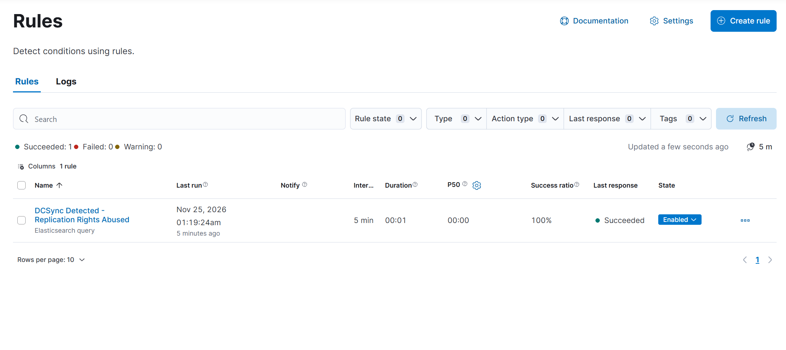
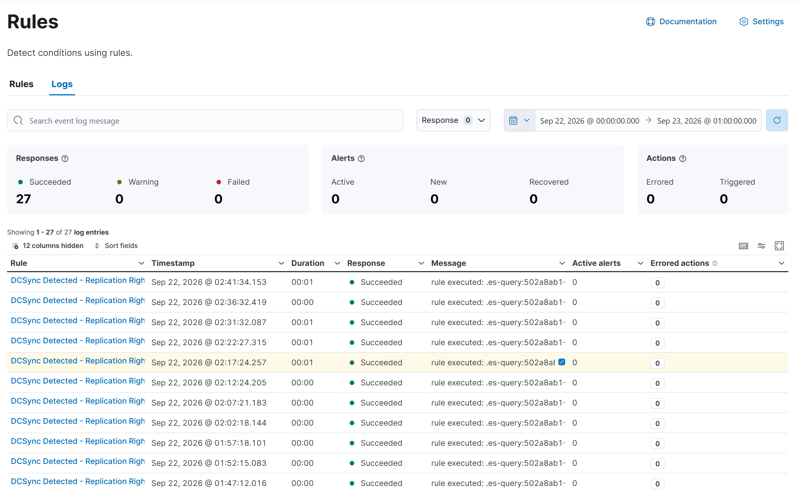

# Detection Validation Results

Operation: `AD Credential Access Chain`, run through Caldera on 22 September 2026 from the Kali Sandcat agent (`192.168.18.70`).

I checked two different things for each technique, and they need to be kept apart:

1. **Did the attack's events reach Elastic?** I checked this in September with raw searches in Kibana (`winlogbeat-*`).
2. **Did a detection rule raise an alert?** I checked this in November on Kibana's Rules page and in each rule's execution log.

The first check passed for all four Caldera techniques. The second check found no alerts.

## Summary

| Technique | ATT&CK ID | Raw search used | Hits | Alerting rule? | Alert? | Status |
|---|---|---|---|---|---|---|
| Password Spraying | T1110.003 | `event.code:4771` | 28 | No | No | Gap |
| Kerberoasting | T1558.003 | `event.code:4769 and winlog.event_data.TicketEncryptionType:"0x17"` | 2 | No | No | Not validated |
| AS-REP Roasting | T1558.004 | `event.code:4768 and winlog.event_data.PreAuthType:"0"` | 8 | No | No | Not validated |
| DCSync | T1003.006 | `event.code:4662` | 8 | Yes | No | Not validated |
| LLMNR/NBT-NS Poisoning | T1557.001 | none | 0 | No | No | Gap |

Two notes on the raw searches:

- They are broader than the Sigma rules. The DCSync search matches every 4662 event, not only ones carrying the replication GUIDs from a non-DC account. The Kerberoasting search doesn't apply the rule's filters. So the hit counts show the telemetry exists. They don't show the rule logic works.
- The password spray hits are 4771 events. The Sigma rule only looks at 4625, so it could not have matched them.

## Rule check (November 2026)

As of 25 November, Kibana's Rules page holds one rule: "DCSync Detected - Replication Rights Abused," an Elasticsearch query rule running every 5 minutes.

The rule's execution log for 22 September 2026 shows 27 successful runs and 0 alerts (Active 0, New 0, Recovered 0). No other rule has runs logged for that day.

I haven't yet confirmed whether the rule was running before the operation started, or why it didn't alert. That's step 4 of the re-test plan in the [README](../README.md#re-test-plan).

## Evidence per technique

### Password Spraying (T1110.003)

- Event: 4771, Kerberos pre-authentication failed
- Account shown: `oscar.martinez`
- Failure code: `0x18` (bad password)
- Source IP: `192.168.18.70` (Kali agent)
- Hits: 28

Why it's a gap: Kerbrute sends Kerberos AS-REQ messages directly, so failures appear as 4771. My Sigma rule (`password_spraying_distributed_failures.yml`) counts distinct usernames in 4625 events, which Kerbrute never produces.

### Kerberoasting (T1558.003)

- Event: 4769, Kerberos service ticket requested
- Ticket encryption type: `0x17` (RC4-HMAC)
- Hits: 2

Note for the re-test: the tuned Sigma rule (v0.2.0) allow-lists `svc_sql`, which is the account this operation roasts. Deployed as it is, the rule would ignore this attack.

### AS-REP Roasting (T1558.004)

- Event: 4768, Kerberos TGT requested
- Account: `j.jenkins`
- PreAuthType: `0` (pre-authentication not required)
- Hits: 8

### DCSync (T1003.006)

- Event: 4662, Directory Service Access
- Outcome: success
- Host: `Joshua-Server2022`
- Hits: 8

The search was `event.code:4662` on its own. I didn't filter on the replication GUIDs or the subject account, so these hits show auditing was working. They don't show which account requested replication.

### LLMNR/NBT-NS Poisoning (T1557.001)

I ran this manually with Responder, not through Caldera. No events reached Elastic, because Sysmon Event IDs 3 (network connection) and 22 (DNS query) weren't firing on the endpoint. See [`llmnr-known-gap.md`](llmnr-known-gap.md).
